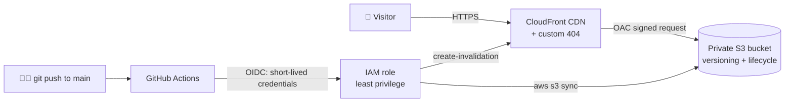

<div align="center">

# ☁️ Static Website on AWS: S3 + CloudFront + GitHub Actions

**A secure, fast and fully automated portfolio website on AWS, with a private S3 bucket, a global CDN, HTTPS and keyless CI/CD.**


</div>

---

## 📌 Overview

This project hosts a static portfolio website on AWS the way it is done in production:

- The **S3 bucket is private.** Nobody can open files directly from S3.
- **CloudFront** serves the site worldwide over **HTTPS**, using **Origin Access Control (OAC)** to read from the bucket.
- **GitHub Actions** deploys every push to `main` using **OIDC**, so **no AWS access keys are stored** in GitHub.
- **Least-privilege IAM:** the deploy role can only touch this one bucket and this one distribution.
- **Smart caching, versioning and lifecycle rules** keep the site fast, recoverable and cheap.

---

## 🗺️ Architecture



---

## ✨ Features

| Feature | How it works | Why it matters |
|---|---|---|
| 🔒 **Private bucket** | S3 Block Public Access stays on; a bucket policy allows only this CloudFront distribution (OAC) | Files can't be read or scraped directly from S3 |
| 🌍 **Global CDN + HTTPS** | CloudFront with HTTP → HTTPS redirect | Fast loading worldwide and encrypted traffic |
| 🔑 **Keyless CI/CD** | GitHub Actions assumes an IAM role through OIDC | No long-lived AWS keys to leak |
| 🛡️ **Least privilege** | The deploy role can only list, put and delete objects in this bucket and invalidate this distribution | Limits the damage if anything goes wrong |
| ⚡ **Smart caching** | CSS/JS/images cached for 1 day; HTML set to `max-age=0, must-revalidate` | Fast pages, and new content shows up immediately |
| ♻️ **Versioning + lifecycle** | Old file versions kept 30 days, then deleted automatically | Easy rollback without growing storage costs |
| 🚫 **Custom 404 page** | CloudFront maps 403/404 errors to `/404.html` | A friendly page instead of an XML error |

---

## 📂 Project Structure

```
s3-static-website/
├── site/                         # 🌐 The website
│   ├── index.html
│   ├── about.html
│   ├── 404.html
│   ├── css/style.css
│   └── js/main.js
│
├── aws/                          # 📜 Policy templates (with placeholders)
│   ├── bucket-policy.json        # Lets ONLY this CloudFront distribution read the bucket
│   ├── github-trust-policy.json  # Lets GitHub Actions (this repo, main branch) assume the role
│   ├── github-deploy-policy.json # What the deploy role is allowed to do
│   └── lifecycle.json            # Delete old object versions after 30 days
│
├── scripts/                      # 🛠️ Automation
│   ├── vars.sh                   # Project settings (bucket, region, IDs)
│   ├── create-cloudfront.sh      # Creates OAC + distribution, saves the ID, applies bucket policy
│   ├── render-policies.sh        # Fills real values into the templates → build/
│   ├── deploy.sh                 # Syncs site/ to S3 and invalidates the CloudFront cache
│   └── test-site.sh              # Checks HTTPS, caching, redirects, 404 and private bucket
│
├── .github/workflows/
│   └── deploy.yml                # CI/CD: deploy on every push to main
│
├── build/                        # Generated policies (ignored by Git)
└── README.md
```

---

## ✅ Prerequisites

- An **AWS account** (free tier is enough)
- **AWS CLI v2**, with credentials from an IAM role or `aws configure`
- **Git** and a **GitHub** account
- A Linux/macOS shell (tested on Ubuntu 24.04 on AWS EC2)

---

## 🚀 Setup

### 1️⃣ Configure the project
Edit `scripts/vars.sh`:

```bash
export BUCKET="your-unique-bucket-name"        # lowercase, globally unique
export AWS_REGION="us-east-1"
export GITHUB_USER="your-github-username"
export REPO_NAME="s3-static-website"
```

```bash
source scripts/vars.sh
```

### 2️⃣ Create the bucket
```bash
aws s3api create-bucket --bucket "$BUCKET" --region "$AWS_REGION"
aws s3api put-bucket-versioning --bucket "$BUCKET" --versioning-configuration Status=Enabled
aws s3api put-bucket-lifecycle-configuration --bucket "$BUCKET" --lifecycle-configuration file://aws/lifecycle.json
```

### 3️⃣ Upload the site
```bash
bash scripts/deploy.sh
```

### 4️⃣ Create CloudFront and lock down the bucket
```bash
bash scripts/create-cloudfront.sh
```
This creates the OAC and the distribution (HTTPS, `index.html`, custom 404), saves the Distribution ID into `vars.sh`, and applies the bucket policy. Deployment takes about 5–10 minutes.

### 5️⃣ Set up GitHub Actions (OIDC)
1. In **IAM → Identity providers**, add an OpenID Connect provider:
   - URL: `https://token.actions.githubusercontent.com`
   - Audience: `sts.amazonaws.com`
2. Create the deploy role from the rendered policies:
```bash
bash scripts/render-policies.sh
aws iam create-role --role-name github-actions-s3-deploy \
  --assume-role-policy-document file://build/github-trust-policy.json
aws iam put-role-policy --role-name github-actions-s3-deploy \
  --policy-name s3-website-deploy --policy-document file://build/github-deploy-policy.json
```
3. In **GitHub → Settings → Secrets and variables → Actions → Variables**, add `AWS_ROLE_ARN`, `BUCKET` and `DISTRIBUTION_ID`.
4. Push to `main`. The workflow deploys automatically. 🎉

---

## 🔄 How a deploy works

1. `aws s3 sync` uploads **CSS, JS and images** with a 1-day cache.
2. `aws s3 sync` uploads **HTML** with `max-age=0, must-revalidate`.
3. `--delete` removes files from S3 that were deleted locally (recoverable for 30 days via versioning).
4. A **CloudFront invalidation** (`/*`) makes visitors get the newest version.

---

## 🔎 Testing

```bash
bash scripts/test-site.sh
```

| Check | Expected result |
|---|---|
| HTTPS works | `HTTP/2 200` |
| CDN caching | `x-cache: Miss`, then `Hit from cloudfront` |
| HTTP → HTTPS | `301` with `location: https://...` |
| Missing page | `HTTP/2 404` (custom page) |
| Direct S3 access | `403 Forbidden` ✅ (the bucket is private) |

---

## 🧠 What I Learned

- Serving a **private S3 bucket** through CloudFront with **Origin Access Control**
- Writing **least-privilege IAM policies** and **trust policies**
- **Keyless CI/CD** with GitHub Actions and **OIDC**
- **Cache-Control** strategy and **CloudFront invalidations**
- **S3 versioning and lifecycle rules** for safe rollbacks and cost control
- Automating infrastructure with **Bash** and the **AWS CLI**

---

## 💰 Cost

Runs within the **AWS Free Tier** for a small personal site (S3 storage, CloudFront transfer and requests). No custom domain is required: CloudFront provides a free `*.cloudfront.net` address with HTTPS.

---

## 🔮 Roadmap

- [ ] Custom domain with **Route 53** + **ACM** certificate
- [ ] **Security headers** response policy (HSTS, X-Frame-Options, etc.)
- [ ] Rewrite the infrastructure in **Terraform**
- [ ] Add HTML and link checks to the CI pipeline

---

## 👤 Author

<div align="center">

**Zeeshan Haider**, Junior DevOps Engineer

⭐ **If this project helped you, consider giving it a star!**

</div>[](https://www.linkedin.com/in/zeeshan-haider-a64917378/)

IF YOU PEOPLE WANT TO LOOK MY LIVE WEBSITE THEN IT WOULD BE LIKE THAT

## 🌐 Live Website

**[https://ddhud87f3cplr.cloudfront.net](https://ddhud87f3cplr.cloudfront.net)*
